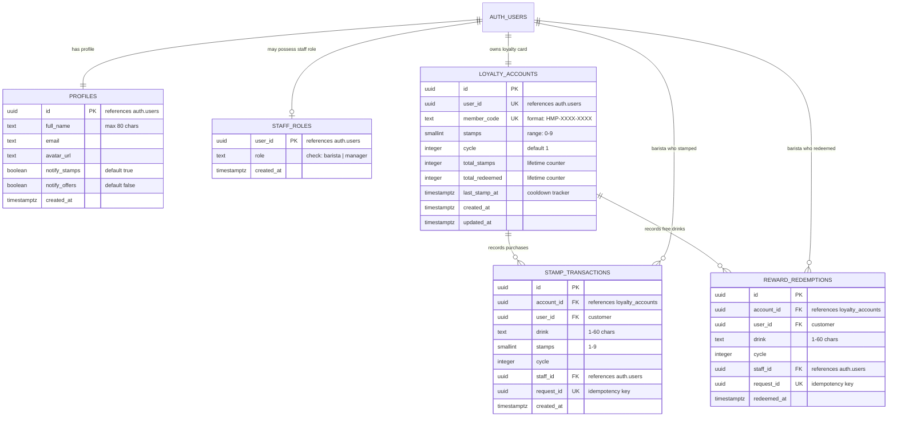

# Database Schema

> Read this document before querying or modifying database tables, functions, triggers, or views.

---

## 1. Entity-Relationship Overview



---

## 2. Table Specifications

### `public.profiles`
Stores customer personal profile information and notification preferences. Linked 1:1 with `auth.users`.
- `id` (`uuid`, Primary Key): References `auth.users(id) ON DELETE CASCADE`.
- `full_name` (`text`, Not Null, Default `''`, Check: `char_length(full_name) <= 80`): Customer's display name.
- `email` (`text`, Not Null): Mirrored customer email.
- `avatar_url` (`text`, Nullable): Optional URL to customer profile image.
- `notify_stamps` (`boolean`, Not Null, Default `true`): In-app push/notification preference for stamps.
- `notify_offers` (`boolean`, Not Null, Default `false`): Promotional announcement preference.
- `created_at` (`timestamptz`, Not Null, Default `now()`).

### `public.staff_roles`
Defines operational permissions. Only accounts present in this table can access `/staff` and execute barista RPCs.
- `user_id` (`uuid`, Primary Key): References `auth.users(id) ON DELETE CASCADE`.
- `role` (`text`, Not Null, Check: `role in ('barista', 'manager')`): Staff permission level.
- `created_at` (`timestamptz`, Not Null, Default `now()`).

### `public.loyalty_accounts`
The primary digital loyalty card state machine.
- `id` (`uuid`, Primary Key, Default `gen_random_uuid()`).
- `user_id` (`uuid`, Not Null, Unique): References `auth.users(id) ON DELETE CASCADE`.
- `member_code` (`text`, Not Null, Unique, Check: `member_code ~ '^HMP-[A-Z0-9]{4}-[A-Z0-9]{4}$'`): Human-readable code displayed to staff and encoded in QR.
- `stamps` (`smallint`, Not Null, Default `0`, Check: `stamps between 0 and 9`): Stamps in the current cycle.
- `cycle` (`integer`, Not Null, Default `1`, Check: `cycle >= 1`): Current card cycle number (increments after every reward redemption).
- `total_stamps` (`integer`, Not Null, Default `0`): Lifetime total stamps awarded.
- `total_redeemed` (`integer`, Not Null, Default `0`): Lifetime free drinks claimed.
- `last_stamp_at` (`timestamptz`, Nullable): Timestamp of the most recent stamp transaction, used for the 10-second cooldown check.
- `created_at` / `updated_at` (`timestamptz`, Not Null, Default `now()`).

### `public.stamp_transactions`
Audit trail of purchases that earned stamps.
- `id` (`uuid`, Primary Key, Default `gen_random_uuid()`).
- `account_id` (`uuid`, Not Null): References `loyalty_accounts(id) ON DELETE CASCADE`.
- `user_id` (`uuid`, Not Null): References `auth.users(id) ON DELETE CASCADE`.
- `drink` (`text`, Not Null, Check: `char_length(drink) between 1 and 60`): Purchased coffee item.
- `stamps` (`smallint`, Not Null, Default `1`, Check: `stamps between 1 and 9`): Quantity of stamps awarded in this transaction.
- `cycle` (`integer`, Not Null): The card cycle active when this transaction occurred.
- `staff_id` (`uuid`, Nullable): References `auth.users(id) ON DELETE SET NULL` (identifies the barista).
- `request_id` (`uuid`, Not Null, Unique): Client-generated UUID ensuring idempotent retries.
- `created_at` (`timestamptz`, Not Null, Default `now()`).
- **Indexes**: `stamp_transactions_user_idx (user_id, created_at desc)`.

### `public.reward_redemptions`
Audit log of claimed free drinks.
- `id` (`uuid`, Primary Key, Default `gen_random_uuid()`).
- `account_id` (`uuid`, Not Null): References `loyalty_accounts(id) ON DELETE CASCADE`.
- `user_id` (`uuid`, Not Null): References `auth.users(id) ON DELETE CASCADE`.
- `drink` (`text`, Not Null, Check: `char_length(drink) between 1 and 60`): The free drink selected.
- `cycle` (`integer`, Not Null): The completed card cycle.
- `staff_id` (`uuid`, Nullable): References `auth.users(id) ON DELETE SET NULL` (the barista who approved redemption).
- `request_id` (`uuid`, Not Null, Unique): Client idempotency UUID.
- `redeemed_at` (`timestamptz`, Not Null, Default `now()`).
- **Constraints**: `UNIQUE (account_id, cycle)` — mathematically prevents a completed card from being redeemed multiple times.
- **Indexes**: `reward_redemptions_user_idx (user_id, redeemed_at desc)`.

---

## 3. Views

### `public.activity_feed`
Unified chronological feed of stamps and redemptions queried by the Activity page:
```sql
create view public.activity_feed with (security_invoker = true) as
  select id, 'stamp'::text as kind, drink, stamps::int as stamps, cycle, created_at, user_id
    from public.stamp_transactions
  union all
  select id, 'redemption'::text, drink, 0, cycle, redeemed_at, user_id
    from public.reward_redemptions;
```
*Note*: `security_invoker = true` ensures RLS filtering from the underlying tables applies transparently.

---

## 4. Functions & Triggers

### 1. `public.generate_member_code() -> text`
- Generates unconfusing 8-character alphanumeric codes in `HMP-XXXX-XXXX` format.
- Uses a 32-character alphabet excluding ambiguous glyphs (`0`, `O`, `1`, `I`):
  `ABCDEFGHJKLMNPQRSTUVWXYZ23456789`.
- Loops until a unique code is found.

### 2. `public.handle_new_user() -> trigger`
- Attached to `auth.users AFTER INSERT`.
- Automatically provisions corresponding rows in `public.profiles` and `public.loyalty_accounts`.

### 3. `public.is_staff() -> boolean`
- Checks whether `auth.uid()` has an entry in `public.staff_roles`.

### 4. `public.staff_lookup(p_member_code text)`
- Returns customer details (`member_code`, `full_name`, `stamps`, `cycle`).
- Verifies barista status via `assert_staff()`.

### 5. `public.staff_award_stamps(p_member_code, p_drink, p_quantity, p_request_id)`
- Atomic, transactional procedure to award stamps.
- Acquires `FOR UPDATE` lock on `loyalty_accounts`.
- Handles duplicate request retries idempotently.
- Validates that stamps do not exceed 9 and respects the 10-second cooldown.

### 6. `public.staff_redeem_reward(p_member_code, p_drink, p_request_id)`
- Atomic procedure to redeem the 10th free cup.
- Verifies `stamps = 9`.
- Inserts audit row in `reward_redemptions`, resets `stamps = 0`, increments `cycle = cycle + 1`, and increments `total_redeemed = total_redeemed + 1`.

